# Blades dashboard screenshot gallery

Recreated on **1 November 2026** from the saved custom dashboard at commit
[`912421c`](https://github.com/kierzo89/Hearth/commit/912421c4cfa0a1041c5b22768b425703f6eda9a9).
These are local renders with demo app/input data, not original historical TV captures.
The TV was not changed. No personal wallpaper, account data or credentials appear.

Each image is a **1920 × 1080 PNG**. Click an image to open its full-size file;
use GitHub’s download control to save it.

[Feature summary](../README.md#what-ive-added) · [Custom source branch](https://github.com/kierzo89/Hearth/tree/main)

The metallic artwork and navigation sounds from MC360 are now bundled with their
original credits; CSS gradients and synthesised sounds remain as fallbacks. See the
[licence and asset notes](https://github.com/kierzo89/Hearth/blob/main/THIRD_PARTY_NOTICES.md).

## Overview

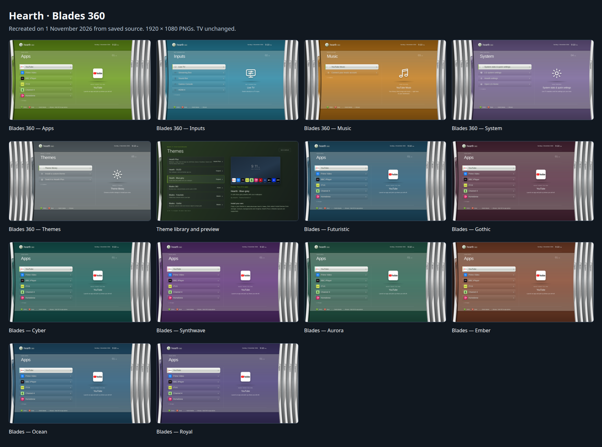

## Blades 360 — Apps

[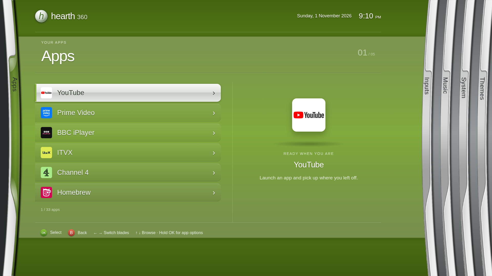](screenshots/blades/01-blades-apps.png)

## Blades 360 — Inputs

[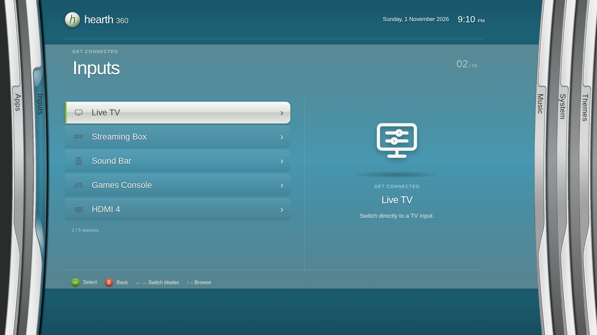](screenshots/blades/02-blades-inputs.png)

## Blades 360 — Music

[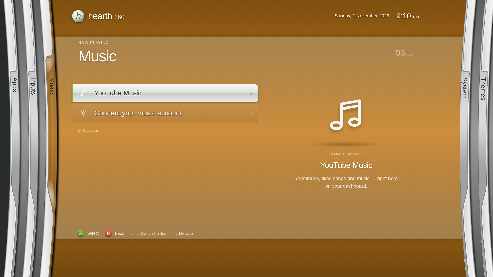](screenshots/blades/03-blades-music.png)

## Blades 360 — System

[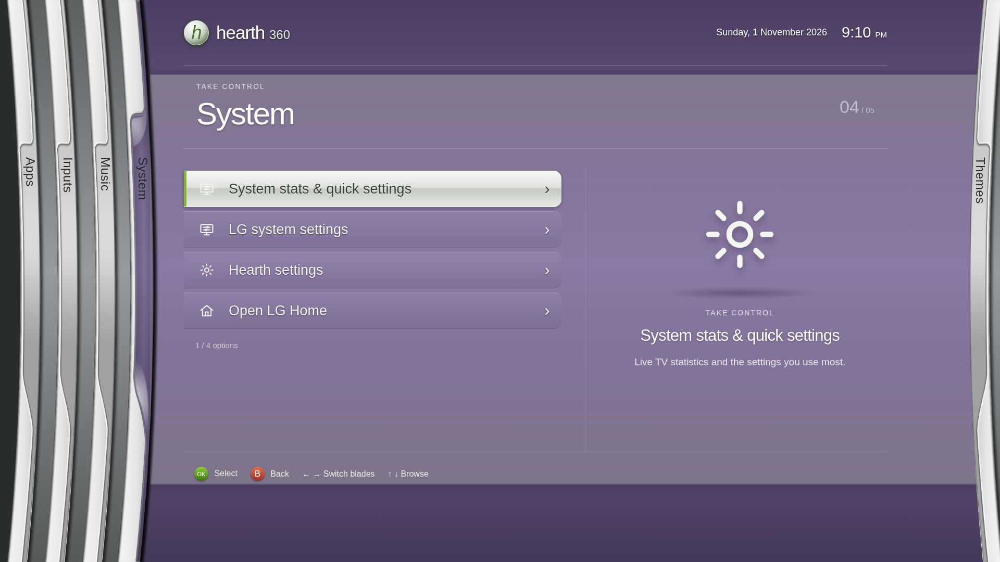](screenshots/blades/04-blades-system.png)

## Blades 360 — Themes

[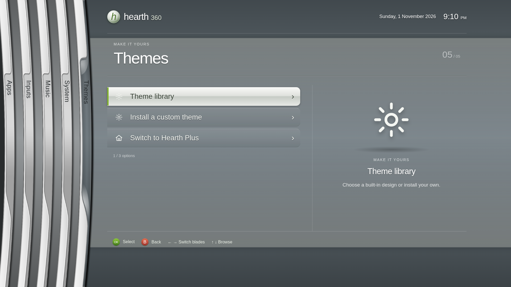](screenshots/blades/05-blades-themes.png)

## Theme library and preview

[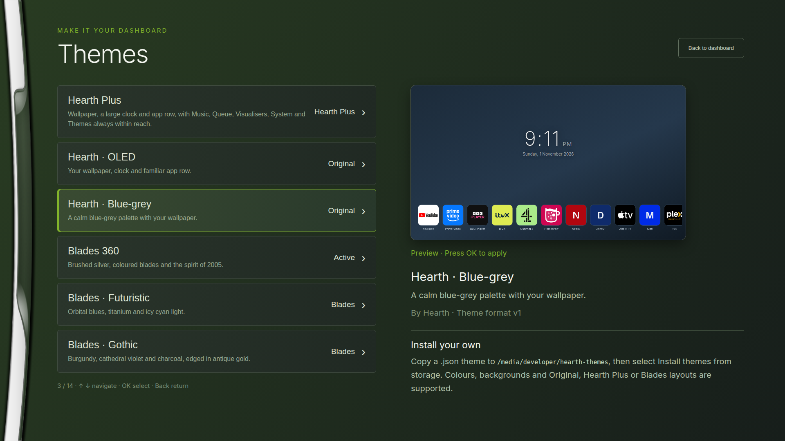](screenshots/blades/06-theme-library.png)

## Blades — Futuristic

[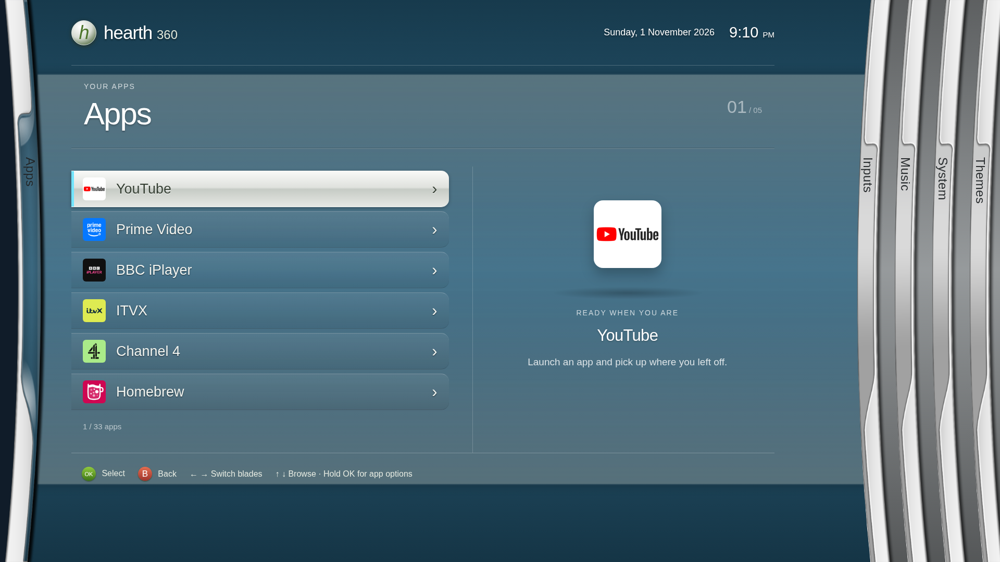](screenshots/blades/07-blades-futuristic.png)

## Blades — Gothic

[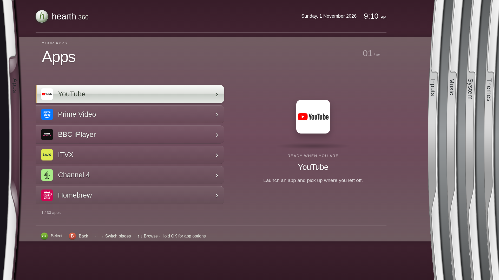](screenshots/blades/08-blades-gothic.png)

## Blades — Cyber

[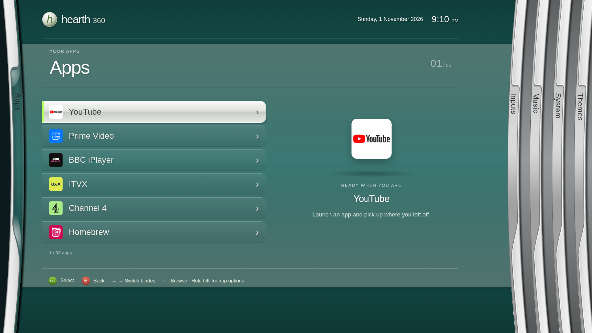](screenshots/blades/09-blades-cyber.png)

## Blades — Synthwave

[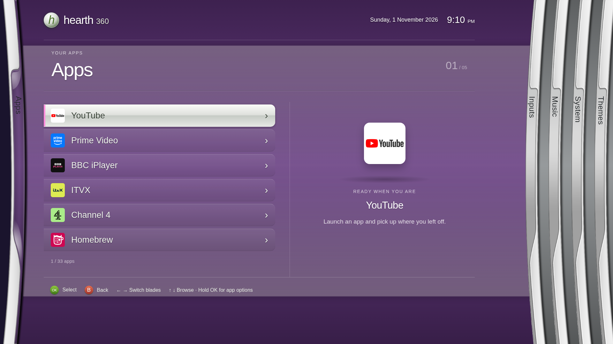](screenshots/blades/10-blades-synthwave.png)

## Blades — Aurora

[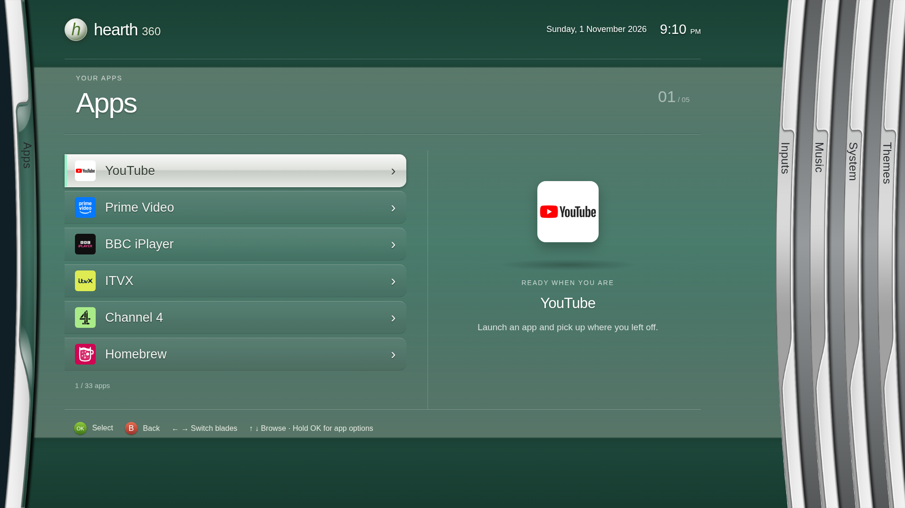](screenshots/blades/11-blades-aurora.png)

## Blades — Ember

[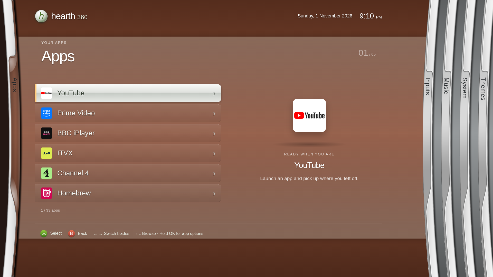](screenshots/blades/12-blades-ember.png)

## Blades — Ocean

## Blades — Royal

[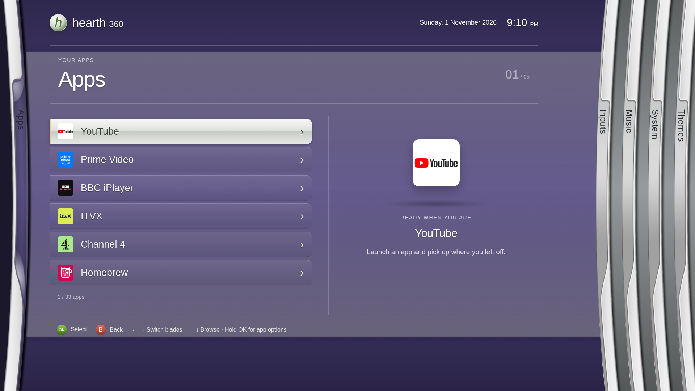](screenshots/blades/14-blades-royal.png)
